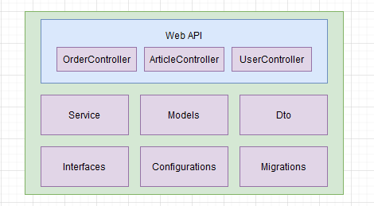
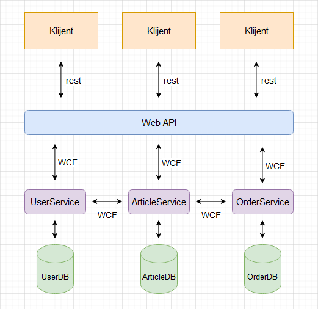
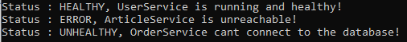

# Bachelor's Thesis: Implementation of Observability in a Microservice Architecture of an Online Shop

Migration of a monolithic online shop web application to a microservice architecture, with observability patterns (health check API, log aggregation and exception tracking) for real-time visibility into the system.

| | |
|---|---|
| **Original title (Serbian)** | *Implementacija observabilnosti mikroservisne arhitekture onlajn prodavnice* |
| **Degree** | Bachelor's degree (Undergraduate Academic Studies), Electrical and Computer Engineering |
| **Study programme** | Power Software Engineering (*Primenjeno softversko inženjerstvo*) |
| **University** | Faculty of Technical Sciences, University of Novi Sad |
| **Mentor** | Sebastijan Stoja, PhD, Assistant Professor |
| **Year** | 2023 |
| **Language** | Serbian, with an English abstract |

📄 **[Read the full thesis (PDF, in Serbian)](bachelor-thesis.pdf)**

## Abstract

This thesis implements observability patterns such as the health check API, log aggregation and exception tracking in a microservice architecture of an online shop, enabling microservices with full real-time visibility.

## Thesis Goal

The task of the thesis was to:
- Review the literature on microservices and identify possible ways to split existing services into microservices
- Split a monolithic online shop application into microservices
- Apply observability patterns so the microservices have full real-time visibility
- Provide an overview page or an adapter for monitoring the system

## Features

The online shop supports three user roles:
- **Administrator:** approves or rejects customer registrations and verifies sellers
- **Seller:** adds products to the shop
- **Customer:** places orders by choosing products and quantities

Users log in with **JWT authentication**, and access is controlled by role.

## Architecture

### Starting point: monolithic application

The original application was a single ASP.NET Core Web API with three controllers (users, articles and orders), one built-in service layer and a single shared database.

### Result: microservice architecture

The application was split into three independent services, each with its own database:

| Service | Responsibility | Database |
|---|---|---|
| **UserService** | User accounts, registration and verification | UserDB |
| **ArticleService** | Products created by sellers | ArticleDB |
| **OrderService** | Customer orders | OrderDB |

- Clients communicate with the **Web API** over **REST**
- The Web API keeps the same controllers and communicates with the services over **WCF using TCP**
- Services also communicate with **each other** over WCF/TCP through separate internal interfaces
- Separate database models, WCF data contracts and DTOs, mapped with **AutoMapper**

## Observability Patterns

- **Exception tracking:** each service logs its exceptions to its own log file and throws a `FaultException`, which propagates to the Web API so the client can be notified properly
- **Health check API:** each service exposes a health check endpoint over WCF/TCP that verifies its database connection and reports whether the service is healthy, unhealthy or down
- **Log aggregation:** a separate adapter component collects the log files from all services and displays every exception in one place, along with the current health of each service

## Testing

The thesis tests the implemented patterns in practice:
- Registering with an existing email or username logs the exception in UserService's log file
- With OrderService's database deleted, ArticleService stopped and UserService running normally, the adapter correctly reports OrderService as **unhealthy** (still running but unable to reach its database), ArticleService as **down** and UserService as **healthy**

## Conclusion

Migrating the online shop from a monolith to microservices removed the main weaknesses of the original application: it was tightly coupled, hard to maintain, and a single error could bring down the whole system. With independent services and a separate database per service, a failure in one service no longer stops the others, and the application becomes easier to scale, maintain and debug.

The implemented observability patterns make the system's state visible in real time: the health of each service, as well as the errors and exceptions that occur, can be monitored from one place.

The thesis also concludes that microservices aren't always the right choice. For small applications with few components and low traffic, a monolith is often simpler and the migration isn't worth it, while large, complex applications with many components and requests benefit the most. The choice of how to split the services should be made carefully.

## Future Improvements

As discussed in the conclusion of the thesis:
- Replace WCF, which is no longer actively developed, with **gRPC** for faster and more modern service-to-service communication
- Use raw SQL queries instead of Entity Framework in performance-critical paths

## Tech Stack

C#, .NET, ASP.NET Core Web API, WCF (TCP), Entity Framework, Microsoft SQL Server 2019 Express, AutoMapper, Serilog, JWT

## Repository Structure

- `bachelor-thesis.pdf` – the full thesis (in Serbian)
- `images/` – architecture diagrams and screenshots
- `src/` – source code of the microservice application

## Running the Application

### Prerequisites
- Windows with **Visual Studio** (with the .NET desktop and ASP.NET workloads installed)
- **Microsoft SQL Server 2019 Express** (or another SQL Server edition)

### Steps
1. Clone the repository and open the solution in `src/` with Visual Studio.
2. Check the database connection strings in each service's `App.config` (UserService, ArticleService and OrderService). By default they point to `.\SQLEXPRESS` with Windows authentication, so change the server name if your SQL Server instance is different. Each service uses its own database: `UserDB`, `ArticleDB` and `OrderDB`.
3. Restore NuGet packages and build the solution.
4. Set up **multiple startup projects**: right-click the solution → **Configure Startup Projects** → **Multiple startup projects**, then set **UserService**, **ArticleService**, **OrderService**, the **Web API** and the **Adapter** to **Start**. Move the services above the Web API so they start first.
5. Press **F5**. The services start their WCF/TCP endpoints, Entity Framework creates the databases on first run, and the Web API becomes available.
6. Use the **Adapter** console to check the health of all services and view the aggregated exception logs.

> **Note:** You may need to run Visual Studio as administrator so the WCF services can open their TCP endpoints.

---

*Developed as a university project.*
